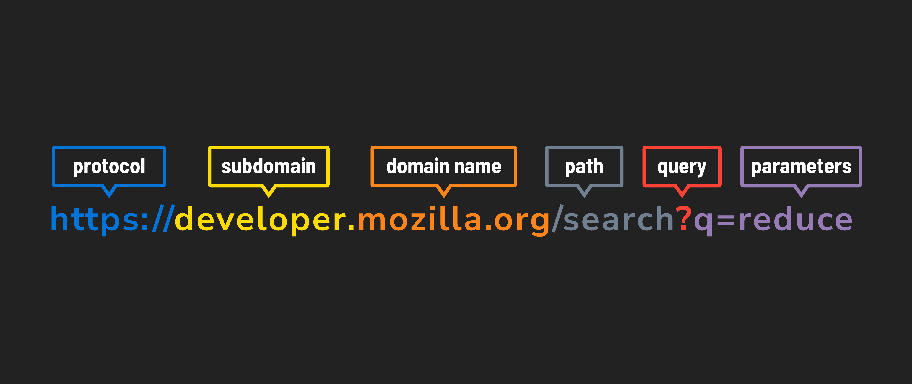

<h1>
  <span class="headline">Exploring APIs with Python</span>
  <span class="subhead">Making an HTTP Request</span>
</h1>

**Learning objective:** By the end of this lesson, students will be able to construct and send HTTP requests to APIs using Python, understand the components of a URL and different HTTP request methods, and handle and parse JSON responses effectively.

| Lesson                 | Duration |
| ---------------------- | -------- |
| Making an HTTP Request | 15 min   |

## APIs Sound Great! How Do I Get Started?

API requests use HTTP, which might look familiar since it's how web browsers access websites.
However, making requests to an API involves a bit more detail, especially when you want to retrieve specific data.

### Anatomy of a URL

When making an API request, you'll use a URL that looks similar to a web address. Here's an example:

```bash
http://www.domain.com:1234/path/to/resource?a=b&x=y
```

This URL might look complex, but it's structured in a way that allows you to request specific information.

## Components of a URL



Go to <https://developer.mozilla.org/search?q=reduce>.

### Components

- **Protocol**: `https` - Signifies a secure, encrypted connection.
- **Subdomain**: `developer.` - A subdomain of the `mozilla.org` domain. Subdomains organize different sections of websites and serve as a distinct section under the domain.
- **Domain name**: `mozilla.org` - Represents the internet address of the website or server.
- **Path**: `/search` - Identifies a specific resource or page, in this case, the search page on the website.
- **Query parameters**: `?q=reduce` - Sends additional information to the server. Here, `q=reduce` indicates a search query for the term "reduce".

## Request Methods

When making a request to an API, you also need to specify the type of action you want to perform. This is done using HTTP methods, each serving a different purpose.

| **Method** | **Purpose**                                                                                         |
| ---------- | --------------------------------------------------------------------------------------------------- |
| **GET**    | Retrieve information.<br> Used by your browser's address bar every time you visit a website.        |
| **POST**   | Send information.<br> Used by most forms to submit data, such as logging in or creating a new post. |
| **PUT**    | Update information.<br> Requests to change information in a database.                               |
| **DELETE** | Delete information.                                                                                 |

Each method tells the server what kind of operation you're trying to perform. For example, when you want to retrieve data, you use the GET method.

## Requesting Data With Python's `requests` Library

Once you've identified the URL and the method, you can make the request using Python's `requests` library. Here's how you can retrieve data:

```python
import requests

url = "https://api.example.com/data"

data = requests.get(url)
```

In this example, `requests.get()` sends a `GET` request to the specified URL, and the response is stored in the data variable.

## Understanding JSON

When you make an API request, the data returned is often in JSON format. JSON, which stands for JavaScript Object Notation, is a lightweight data format that's easy for both humans and machines to read and write.

Here's an example of what JSON data might look like:

```json
{
  "data": "car",
  "make": "ford",
  "model": "explorer",
  "details": {
    "color": "red",
    "mileage": "54019"
  }
}
```


JSON looks similar to Python dictionaries but isn't directly usable in Python without some conversion.

## Dealing With JSON in Python

To work with JSON data in Python, you'll need to convert it into a format that Python can understand—typically a dictionary.

The `requests` library provides a convenient method to handle this conversion:

```python
data = requests.get(url)

parsed_data = data.json()
```

Here, `data.json()` converts the JSON response into a Python dictionary, making it easier to work with.

## Accessing Data in a JSON Object

API responses can be complex, with data nested in multiple layers. To extract the information you need, you'll often have to dig through these layers.

Let's look at an example:

```python
response = {
  "data": "car",
  "make": "ford",
  "model": "explorer",
  "details": {
    "color": "red",
    "mileage": "54019"
  }
}

print(response)                     # Outputs the entire dictionary
print(response["details"])          # Outputs the nested dictionary under "details"
print(response["details"]["color"]) # Outputs the value "red"
```

### Helpful Tips for Working With JSON

- **Use the Browser Inspector**: The browser's developer tools can help you explore complex JSON objects, offering a visual way to understand their structure.
- **Work One Layer at a Time**: When dealing with deeply nested data, access one layer at a time. This approach is more manageable and reduces the risk of errors.
- **Log Intermediate Results**: Print out intermediate results as you navigate through layers of data. This helps you verify that you're accessing the correct parts of the JSON object.

## API Keys

Many APIs require you to include a key with your HTTP request. An API key is a unique identifier that grants you access to the API's resources. You can think of it as a password that helps secure the API and ensure that only authorized users can access its data.


### Why Are API Keys Important?

1. **Security**: API keys help prevent unauthorized access. By issuing keys, the API provider can control who accesses their service and ensure that only legitimate users make requests.

2. **Usage Tracking**: API keys allow providers to monitor how their API is being used. They can track the number of requests made by each key, helping to prevent abuse and ensuring that users stay within their usage limits.

3. **Rate Limiting**: Most APIs impose limits on how many requests you can make in a given time period (ex: 1000 requests per hour). Your API key helps enforce these limits by associating them with your account.

4. **Billing**: If an API has paid tiers, your API key is linked to your billing account. The provider can charge you based on the usage tracked by your key. However, many APIs offer free tiers, so you can start using them without incurring costs.

### How to Get an API Key

To get an API key, you'll typically need to sign up on the API provider's website.

Once you have been given a key, you'll need to include it in the request headers or as part of the API URL. This tells the API that the request is coming from an authorized user.

> Specific API Documentation will dictate how and when to use a key if required for accessing resources.

### Example: Using an API Key

Here's an example of how to include an API key in a request using Python’s `requests` library:

```python
import requests

# Your unique API key
api_key = "your_api_key_here"

# The API endpoint with the API key included in the URL
url = f"https://api.example.com/data?apikey={api_key}"

# Make a GET request with the API key included in the URL
response = requests.get(url)

# Check the response
print(response.json())
```
