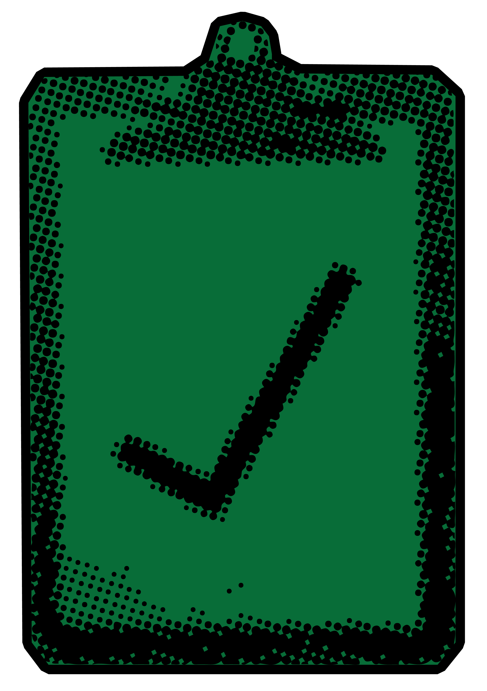
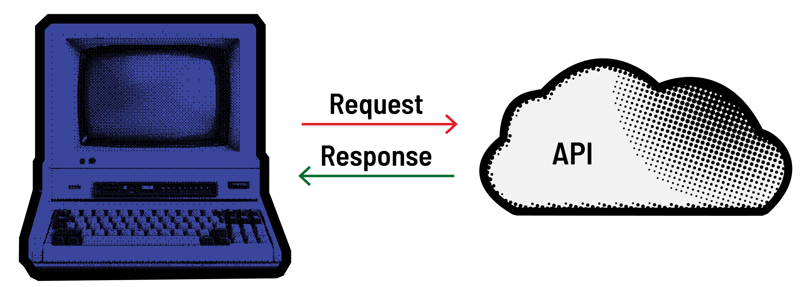

<h1>
  Exploring APIs with Python
  What is an API?
</h1>

**Learning objective:** By the end of this lesson, students will be able to explain what an API is and why they are useful in application development.

| Lesson          | Duration |
| --------------- | -------- |
| What is an API? | 10 min   |

## Our Learning Goals:

- Make HTTP requests for data to external API sources.
- Evaluate API documentation to determine data contents, accessibility, and request formatting.

## What Are APIs?

 

  <h2 class="title">External Data</h2>
  

Have you ever needed information that wasn’t ready to go in a file? Things like reference information, up-to-the-minute updated data, or data from an external vendor or another team within your organization?

**_How did you go about sourcing that information, and what problems did you encounter?_**

- Consider the situations where using an API is the best approach, especially when you need real-time data or information from an external source.
- Be aware of potential issues with external data, such as inconsistent formatting, slow response times, or outdated information. APIs are designed to address these challenges and provide reliable data access.

## Information on Demand

APIs, or **application programming interfaces**, are data sources that can give you access to information from all sorts of places on the internet. Simply put, an API is a system that receives `requests` and returns `responses`.

Many websites show their users information from third-party sources.

> 💡 Thanks to APIs, you can use Python to request and use information from all across the web — whether it’s a weather report, a stock price, or the latest news headlines. It’s time for our programs to become full-fledged citizens of the internet by interacting with other applications.

## It’s All Interfaces?

We encounter interfaces in our daily lives all the time.

Here are a couple of examples:

- **Light Switch**: When you flip a light switch, you don't need to understand how electricity flows or how the light bulb works. You simply expect the light to turn on or off.

- **Vending Machine**: When you insert money and press a button on a vending machine, you don't need to know how the internal mechanisms select and dispense your snack. You just expect to receive what you chose.

APIs allow us to use programming as an interface with other systems. We don’t necessarily care about the inner workings on the other end, we just know how to make things happen.

## What Kind of Data Is Served Up With an API?

It’d be difficult to find data that doesn’t have an API. Common uses are:

- **Maps:** Many apps like Uber, Lyft, and Waze are built on top of existing map services like Google Maps or Mapbox.

- **Translation Services**: Language translation apps or websites often use APIs to connect with powerful translation engines, allowing you to instantly translate text or speech from one language to another.

- **Payment APIs:** When you want to send or receive money via Venmo or the Cash App, the app directly interfaces with your bank or financial institution.

- **Weather Apps**: When you check the weather on an app, it uses an API to pull the latest data from a weather service, providing real-time forecasts and updates for your location.

An extensive list of public APIs can be found here: [Public APIs](https://github.com/public-apis/public-apis)

> Feel free to open that link and browse through the enormous list of APIs - there are APIs for nearly everything.
